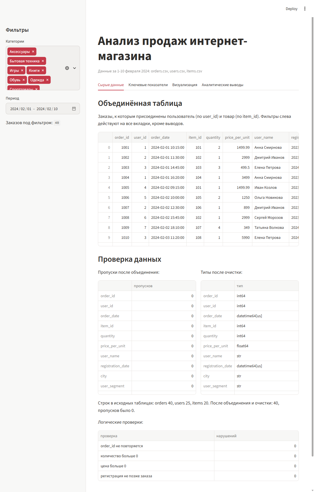
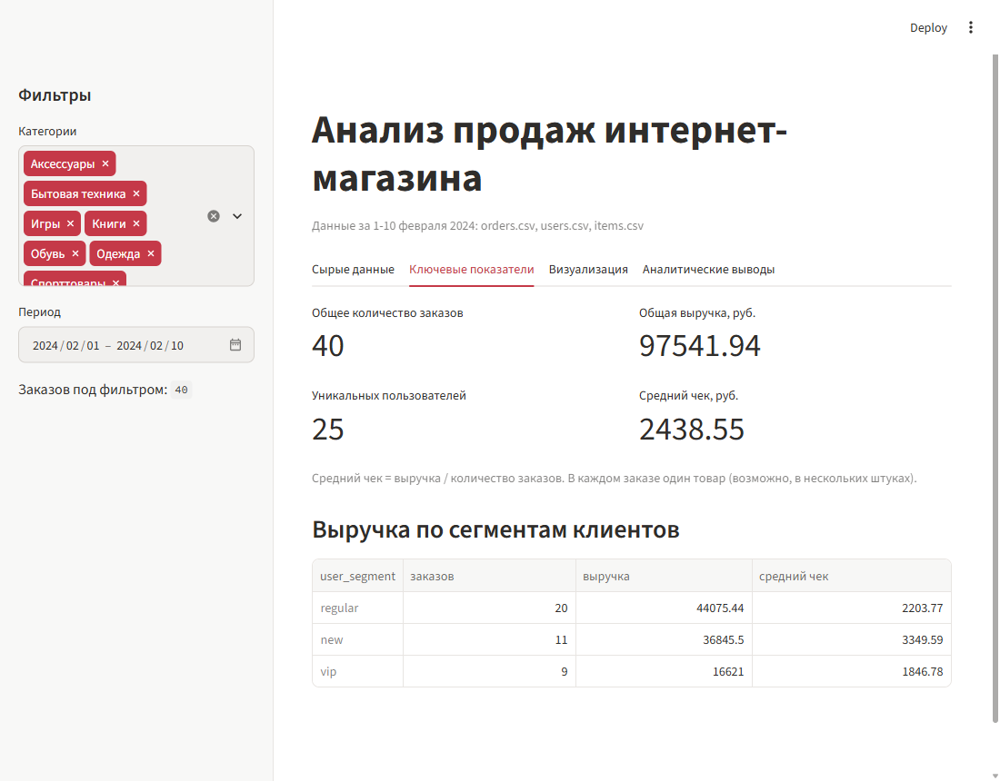
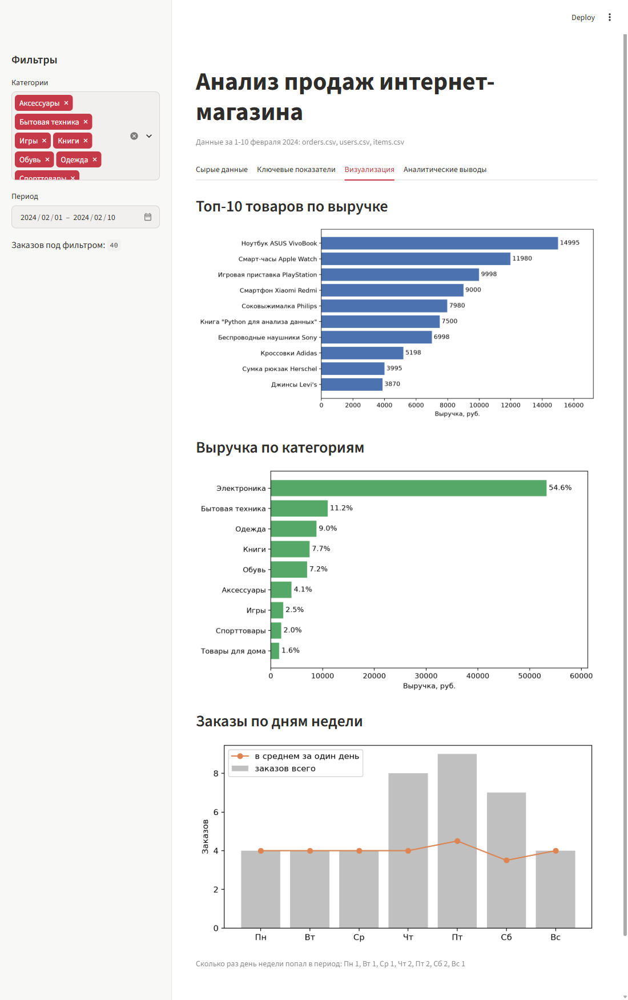
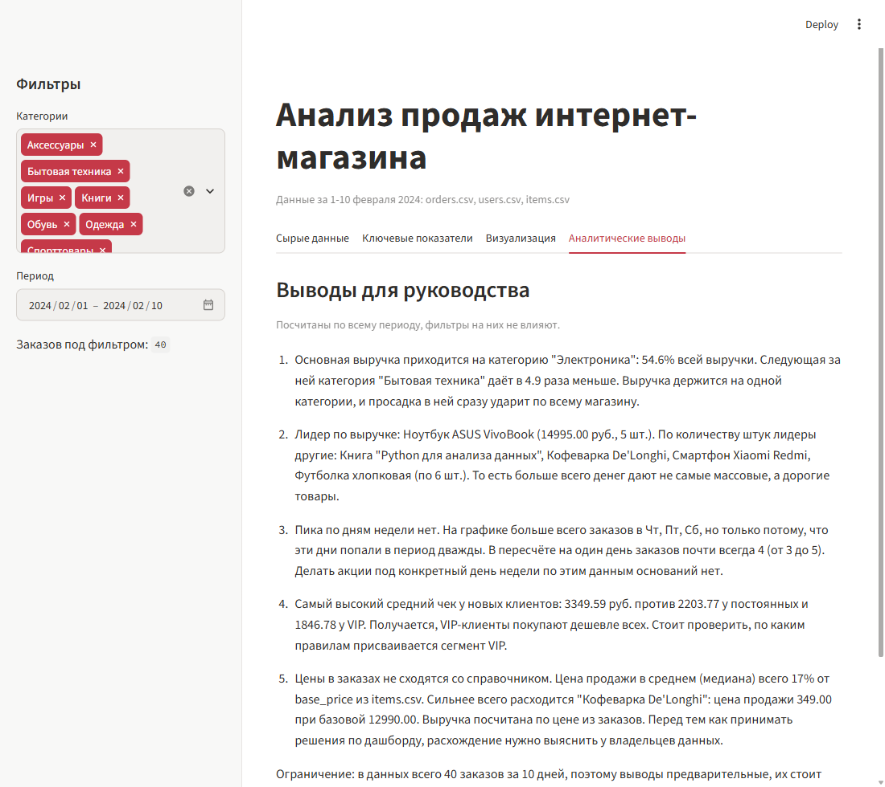

# Дашборд продаж интернет-магазина

Итоговая работа по модулю "Библиотеки Python для анализа данных" (Нетология, курс "Системный аналитик").

Приложение на Streamlit загружает три таблицы (заказы, пользователи, товары), объединяет их, проверяет на пропуски и типы и показывает дашборд из четырёх вкладок: сырые данные, ключевые показатели, графики и аналитические выводы. Слева есть фильтры по категории товара и периоду, они действуют на все вкладки, кроме выводов.

## Запуск

```bash
pip install -r requirements.txt
streamlit run app.py
```

Приложение откроется в браузере по адресу http://localhost:8501. Данные читаются из папки `data/` рядом с `app.py`, так что запускать можно из любой папки.

## Структура

```
shop_dashboard/
├── data/
│   ├── orders.csv     # 40 заказов за 1-10 февраля 2024
│   ├── users.csv      # 25 пользователей
│   └── items.csv      # 20 товаров
├── screenshots/       # снимки дашборда для README
├── app.py             # всё приложение
└── requirements.txt
```

В `app.py` код разбит на блоки по шагам: загрузка (`load_data` с `@st.cache_data`), объединение (`merge_data`), очистка (`clean_data`) и проверки, фильтры, затем по блоку на каждую вкладку. Цифры в выводах подставляются из расчёта, а не вписаны вручную.

## Как обработаны данные

- `orders` соединяется с `users` по `user_id` и с `items` по `item_id` через left join, чтобы ни один заказ не потерялся. У всех 40 заказов нашлись и пользователь, и товар.
- Пропусков после объединения нет. В коде всё равно заложено правило на случай новой выгрузки: строки без даты, количества или цены удаляются, а пустые названия, категории и данные клиента заполняются значением "Unknown".
- Даты приводятся к datetime, количество и цены к числам (`pd.to_numeric(errors="coerce")`).
- Логические проверки на вкладке "Сырые данные": `order_id` не повторяется, количество и цена больше нуля, пользователь зарегистрирован не позже заказа. Нарушений нет.
- Выручка заказа = `quantity * price_per_unit`. Средний чек = выручка / число заказов.

## Результат

| Показатель | Значение |
|------------|---------:|
| Общее количество заказов | 40 |
| Общая выручка | 97 541.94 руб. |
| Уникальных пользователей | 25 |
| Средний чек | 2 438.55 руб. |

Цифры сверил отдельным расчётом в pandas, совпадают.









## Основные выводы

1. Электроника даёт 54.6% выручки, следующая категория (бытовая техника) в 4.9 раза меньше.
2. Лидер по выручке: ноутбук ASUS VivoBook (14 995 руб.). Больше всего денег приносят дорогие товары, а не самые массовые.
3. Пика по дням недели нет. Чт, Пт и Сб на графике выше только потому, что попали в период дважды. В пересчёте на один день почти всегда ровно 4 заказа.
4. Самый высокий средний чек у новых клиентов (3 349.59 руб.), у VIP самый низкий (1 846.78 руб.).

## Ограничения

- Цена продажи в `orders.csv` не сходится с `base_price` в `items.csv`: в среднем (медиана) это 17% от базовой цены, сильнее всего у кофеварки De'Longhi: 349 при базовой цене 12 990. Выручка посчитана по цене из заказов, но расхождение нужно выяснить у владельцев данных.
- Данных мало: 40 заказов за 10 дней. Выводы предварительные.
